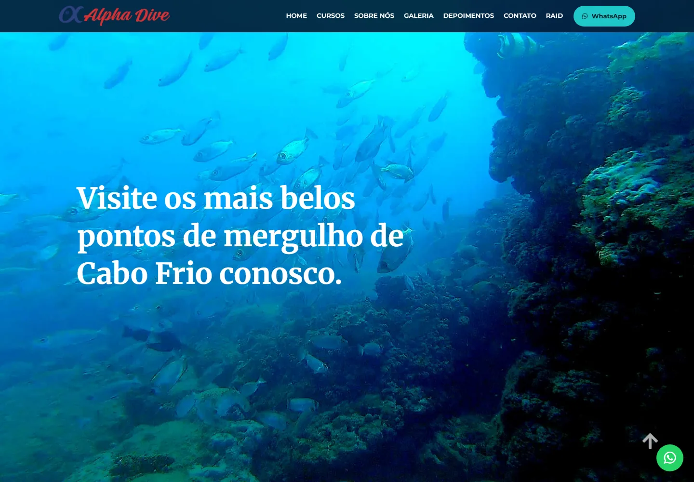
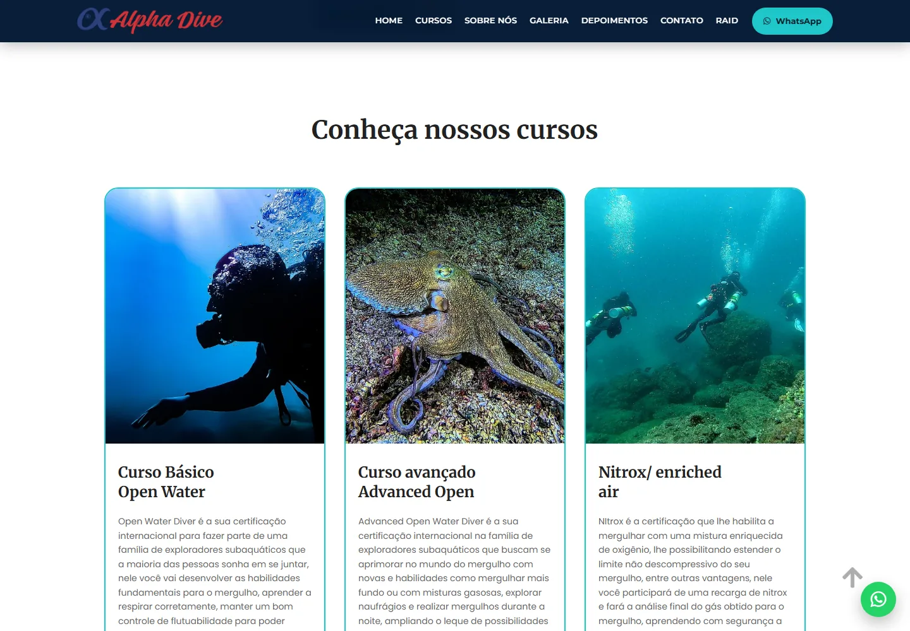
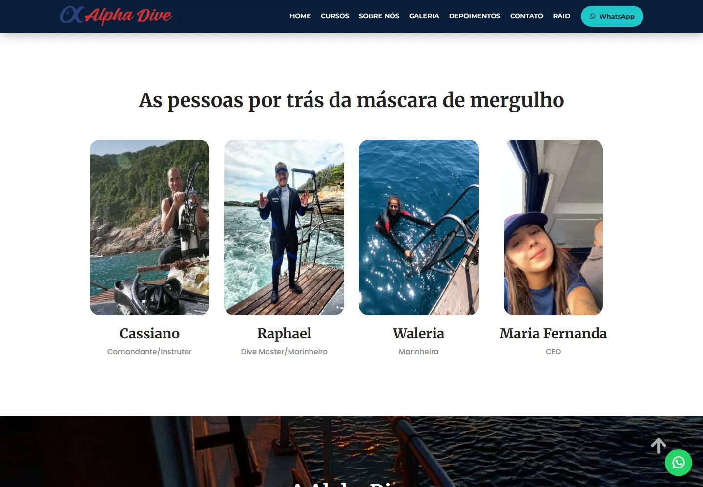
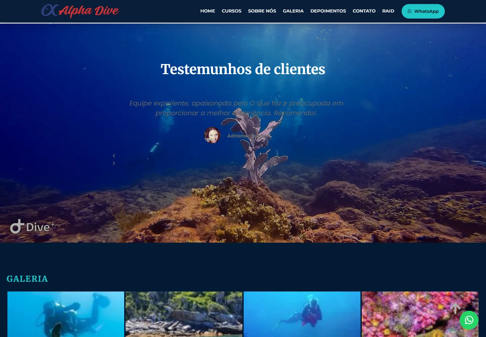

# Alpha Dive Cabo Frio — Migração WordPress para Site Estático

[](https://alphadive.com.br)
[](https://developer.mozilla.org/docs/Web/HTML)
[](https://developer.mozilla.org/docs/Web/CSS)
[](https://developer.mozilla.org/docs/Web/JavaScript)
[](https://www.python.org/)
[](https://pages.github.com/)
[](https://www.cloudflare.com/)

> Migração de um site WordPress/Elementor para uma página única estática, preservando a
> identidade visual, o conteúdo e as URLs antigas — com deploy gratuito no GitHub Pages e DNS
> na Cloudflare.



---

## Visão geral

A **Alpha Dive** é uma operadora e escola de mergulho em Cabo Frio (RJ). O site original rodava
em WordPress com Elementor e Elementor Pro, dependendo de hospedagem, PHP e banco de dados.

Este projeto recria o site como um **artefato 100% estático** a partir de um backup offline,
consolidando 5 páginas em uma única landing page com navegação por âncoras. O resultado elimina
a dependência de servidor dinâmico, reduz custos e permite versionamento e deploy contínuos.

**No ar:** https://alphadive.com.br

---

## Resultados

| Métrica | Valor |
|---|---|
| Páginas consolidadas | 5 → 1 landing page |
| Arquivos versionados | 1.914 |
| Erros de console | 0 |
| Requisições com falha | 0 |
| Vídeo hero | 43,68 MB → 2,19 MB (redução de ~95%) |
| Fontes hospedadas localmente | 103 arquivos `woff2` |
| Página em 1440 px | 12.169 px de altura |
| Dependências de runtime | Nenhuma (sem PHP, sem banco, sem build no servidor) |

---

## Stack

| Camada | Tecnologia |
|---|---|
| Front-end | HTML5, CSS3, JavaScript (vanilla) |
| Build/automação | Python 3 + `lxml` |
| Inspeção da origem | Docker + WordPress + WP-CLI |
| Compressão de vídeo | FFmpeg |
| QA visual | Puppeteer + Chrome headless |
| Hospedagem | GitHub Pages |
| DNS e borda | Cloudflare |
| HTTPS | Let's Encrypt (GitHub Pages) |

---

## Arquitetura da solução

O site publicado é um artefato estático. O build e o backup original ficam em um diretório
local não versionado (`_local/`), porque contêm dados internos da operação.

```
.
├── index.html                # página única final
├── 404.html
├── CNAME                     # domínio customizado
├── .nojekyll                 # desativa o Jekyll no Pages
├── robots.txt
├── sitemap.xml
├── docs/images/              # screenshots deste README
├── wp-content/               # assets de plugins, tema, uploads e fontes
├── wp-includes/              # jQuery, block-library e dependências
├── blog/                     # stubs de redirect para URLs antigas
├── contato/
├── cursos/
├── home/
├── homepage/
├── mergulhe-com-nitrox/
├── raid/
├── sobre-nos/
└── trip-scuba/
```

### Pipeline de build

O script Python (`_local/build_site.py`, fora do repositório) executa quatro etapas
idempotentes:

1. **Montagem** — lê as 5 páginas do espelho, extrai as seções e gera um único `index.html`
   (`#home`, `#sobre`, `#diferenciais`, `#cabo-frio`, `#cursos`, `#equipe`, `#depoimentos`,
   `#galeria`, `#noticias`, `#contato`).
2. **Assets** — copia `wp-content/` e `wp-includes/`, incluindo as fontes locais.
3. **Meta** — gera `CNAME`, `.nojekyll`, `robots.txt`, `sitemap.xml`, `404.html` e os 9 stubs
   de redirect.
4. **Validação** — verifica se todos os assets referenciados existem (resultado: 0 faltantes).

---

## Desafios técnicos

### Incompatibilidade entre Elementor core e Elementor Pro

O backup usava **Elementor 3.33.4** (Swiper 8, classes `.swiper`) com **Elementor Pro 3.16.2**
(markup em `.swiper-container`). O conflito gerava `Class extends value undefined` e quebrava o
carrossel de depoimentos.

Solução em duas frentes:

- **Guard shim** inline antes dos handlers do Elementor, definindo fallbacks para
  `NestedTabs` e `NestedTitleKeyboardHandler`.
- **Carrossel próprio** em JavaScript puro, com autoplay, setas e controle de slide ativo,
  independente do Swiper.

### CSS escopado por página

Cada página tinha um bloco `elementor-frontend-inline-css` com seletores escopados por ID.
Todos os blocos foram mesclados em uma única folha no HTML final.

### URLs e caminhos absolutos

O HTML original referenciava `http://wordpress` e caminhos `../wp-content`. Todos foram
reescritos para caminhos relativos e nenhuma referência ao host interno permaneceu.

### Fontes e privacidade

CSS do Google Fonts e 103 arquivos `woff2` foram hospedados localmente, removendo requisições
a terceiros e melhorando o tempo de carregamento.

### Performance do vídeo

O vídeo de capa original tinha 43,68 MB. Foi recomprimido em 720p, 30 fps, sem áudio, CRF 28 e
`faststart`, resultando em 2,19 MB.

### Compatibilidade de URLs

As URLs antigas continuam funcionando por meio de stubs de redirect:

| URL antiga | Destino |
|---|---|
| `/contato/` | `/#contato` |
| `/cursos/` | `/#cursos` |
| `/sobre-nos/` | `/#equipe` |
| `/blog/`, `/mergulhe-com-nitrox/`, `/trip-scuba/` | `/#noticias` |
| `/raid/` | afiliado DiveRAID |
| `/home/`, `/homepage/` | `/` |

---

## SEO e acessibilidade

- `title`, meta description e canonical.
- Open Graph e Twitter Cards.
- Dados estruturados JSON-LD (`SportsActivityLocation`).
- `robots.txt` e `sitemap.xml`.
- Exatamente um `<h1>` por página.
- Formulário de contato acessível que monta a mensagem e abre o WhatsApp.

---

## QA

- Verificação de assets no build: 0 faltantes.
- Puppeteer em 1440 px: 0 erros de console e 0 requisições falhas.
- Captura full-page e por seção para inspeção visual.
- Testes de redirect em produção.
- Teste de responsividade em viewport mobile (390 px).
- Validação de `www` redirecionando para o domínio raiz.

<p align="center">
  
  
</p>
<p align="center">
  
  
</p>

---

## Autor

**Gabriel Pacheco**

- GitHub: [@gabrielgpacheco](https://github.com/gabrielgpacheco)
- Projeto: [site-estatico-alphadive](https://github.com/gabrielgpacheco/site-estatico-alphadive)
- Site: [alphadive.com.br](https://alphadive.com.br)
